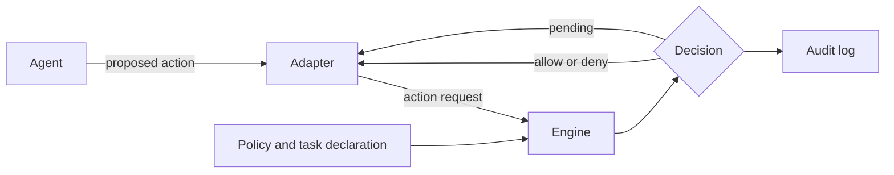

# Shiin

Shiin is an agent-agnostic authorization layer for AI agent actions.
It evaluates proposed actions against explicit policy and structured task constraints, returning `allow`, `deny`, or `pending`.
The source implementation supports local hook evaluation, a Unix approval daemon, signed evidence and replay, a Rust client, an MCP proxy, and a cooperative command wrapper.
Decisions are deterministic and never depend on the output of a language model.

> [!IMPORTANT]
> **Pre-alpha: available from source.**
> The policy engine, CLI, audit log, and experimental task constraints work from a source build.
> Shiin has no releases and is not available from a package manager.
> Codex CLI and Cursor adapters exist and have automated tests, but have not been validated against running hosts.
> Approval, evidence, client, MCP, and command-wrapper implementations exist in source, with partial platform and integration coverage.
> Remote approvals, Windows daemon transport, attested agent identity, and independent security review remain open.

## The problem in 30 seconds

AI coding agents act with the authority of the person who runs them.
An agent that can edit files can also delete them, an agent that can run tests can run any command, and an agent that can fetch documentation can send data to any host the machine can reach.
An agent can make mistakes or follow misleading instructions in the text it reads.
Its standing access can also be broader than the current task needs.

Consider a task to fix a login bug within `src/auth/` and `tests/auth/`.
Standing policy may allow edits throughout the project, while that task should exclude changes to `migrations/`.
Shiin's task constraints narrow the actions standing policy would otherwise allow.

## What works today

| Capability | Current implementation |
|---|---|
| Policy | TOML rules compiled to Cedar, with action, resource, command, and agent matching |
| Decisions | Deterministic evaluation; explicit `deny` wins; the starter policy denies unmatched actions |
| Classification | Path canonicalization, shell-command classification, and opaque effects for behavior the classifier cannot determine |
| Tasks (experimental) | Path scope, forbidden action types, allowed hosts, write/delete/command budgets, required approval, and expiry |
| Hooks | Claude Code adapter, plus Codex CLI and Cursor adapters awaiting live-host validation |
| Approvals | Unix daemon with operator-authenticated resolution, single-use/scoped grants, revocation, and deny-with-ticket |
| Evidence | Hash-chained audit events, signed receipts/checkpoints, offline signature verification, encrypted replay inputs, and what-if replay |
| Integrations | Rust client and local API; MCP upstream stdio with downstream stdio or Streamable HTTP; Unix `shiin exec` command wrapper |
| CLI | Initialization, policy validation and tests, request evaluation, explanations, tasks, hooks, approvals, evidence, execution, and diagnostics |
| Validation | Engine and replay corpus, client/daemon and MCP process integration, fault injection, hosted latency checks, parser fuzzing, Miri, and engine WebAssembly/dependency checks |

The five-stage engine currently accepts asserted identity, and the capability gate requires explicit grants for every action/effect class.
The policy, intent, and risk stages perform the current authorization checks.
Hook adapters are cooperative: actions outside the interception point are outside their coverage.
Creating a policy with `shiin init` does not connect a host to Shiin; configure the host separately.

## How it works

An adapter normalizes a proposed action, the engine evaluates it against policy and the active task, and the hook service records the request and decision before returning a response.



1. **Intercept.** An adapter receives the proposed action from the host, for example through a hook,
   and normalizes it into a host-independent action request.
2. **Evaluate.** The engine runs five stages in a fixed order: identity, capability, policy, intent, and risk.
   A `deny` from any stage wins.
   Unmatched actions use the configured default, which can be `deny` or `pending`, never `allow`.
3. **Enforce.** The adapter returns the decision in the host's own protocol.
   Operational failures handled by the hook service produce a denial response.
4. **Handle pending.** The adapters translate `pending` into a host-facing response.
   In unattended mode, `pending` becomes `deny`.
   With the Unix daemon configured, pending actions receive a ticket for separate operator approval and retry.
5. **Record.** The hook service records each request and decision in the audit log before returning its response.
   The hash chain is tamper-evident; signed receipts and encrypted replay records are available through the evidence commands and configured daemon evidence storage.

Shiin decides whether an action should happen.
A sandbox limits the damage if something runs anyway, so the two are meant to be used together.
[How Shiin works](docs/concepts/how-shiin-works.md) walks through the flow with examples, and [Limitations](docs/concepts/limitations.md) explains what Shiin cannot see.

## What makes Shiin different

Shiin combines four design choices:

1. **Task-intent binding.**
   Actions are checked against the constraints of the task the developer confirmed, not only against standing policy.
2. **An open, agent-neutral contract.**
   The [action request](docs/spec/action-request.md) and [decision](docs/spec/decision.md) have versioned specifications, schemas, and conformance vectors.
   The [approval protocol](docs/spec/approval-protocol.md) has a Unix source implementation and an operator-authenticated command-line approver.
3. **Analyzable policy.**
   TOML policies compile to Cedar today.
   The policy-engine spike passed the conformance corpus, and [ADR-0014](docs/adr/0014-cedar-policy-engine-with-toml-front-end.md) is accepted.
4. **Explicit enforcement levels.**
   Current hook adapters are L1 cooperative.
   The MCP proxy mediates configured traffic; OS-enforced integration remains future work.

## Build and run from source

You need Git and Rust installed through rustup.
The repository pins its Rust toolchain in [`rust-toolchain.toml`](rust-toolchain.toml).
Run these commands from the checkout:

```console
$ git clone https://github.com/BAGOMBEKA-JOB-DEV/shiin.git
$ cd shiin
$ rustup toolchain install
$ cargo build --workspace --locked
$ cargo run --locked -p shiin-cli -- version
$ cargo test --workspace --locked
$ cargo run --locked -p shiin-cli -- policy test docs/spec/test-vectors
```

`cargo run --locked -p shiin-cli -- <command>` runs any implemented CLI command from source.
For a standalone binary, build the release profile:

```console
$ cargo build --release --locked -p shiin-cli
$ ./target/release/shiin version
```

The binary is `target/release/shiin` on Linux and macOS, or `target\release\shiin.exe` on Windows.
See [platform support](docs/reference/platform-support.md) for testing and support tiers.
If you want `shiin` on your Cargo binary path, install this checkout locally:

```console
$ cargo install --locked --path crates/shiin-cli
$ shiin version
```

This installs your source checkout, not a published release.
The examples below use `shiin`; you can substitute the `cargo run` form above.

### Initialize a workspace

Run in the project you want Shiin to evaluate:

```console
$ shiin init
$ shiin policy validate
$ shiin doctor
```

`init` writes `.shiin/policy.toml` and refuses to overwrite an existing policy.
Edit that file to match your project: the starter policy permits selected actions in `src/`, `tests/`, and `docs/`, and selected commands.
You can also validate a specific policy file:

```console
$ shiin policy validate .shiin/policy.toml
```

### Evaluate an action request

Save this illustrative request as `request.json`.
The workspace root is an example path; use your project's absolute, canonical root for your own requests.
The snapshot digest is a placeholder; the hook service fills in the loaded policy digest for host requests.

```json
{
  "schema": "shiin.action-request/v1-draft.1",
  "id": "0190f3a0-1c2d-4e3f-8a4b-5c6d7e8f9aa3",
  "session": "EXAMPLE-session",
  "agent": { "id": "EXAMPLE-agent", "assurance": "asserted" },
  "action_type": "shell.exec",
  "effects": [
    { "kind": "command", "value": "cargo test --workspace --locked", "confidence": "exact" }
  ],
  "workspace": { "root": "/home/dev/project" },
  "policy_snapshot": "sha256:0000000000000000000000000000000000000000000000000000000000000000",
  "host": { "name": "EXAMPLE-host" }
}
```

```console
$ shiin check request.json
$ shiin explain request.json
```

These commands evaluate the request without running its action, recording a hook event, or consuming task budget.
Their exit codes are `0` for `allow`, `1` for `deny` or an error, and `2` for `pending`.

### Declare a task

Run `task start` yourself to confirm the constraints for the agent's work:

```console
$ shiin task start "Fix the login bug" --scope './src/auth/**' --scope './tests/auth/**' --forbid 'fs.delete' --allow-host 'docs.example.com' --ask-for 'vcs.push' --max-writes 20 --max-deletes 0 --max-commands 30 --minutes 60
$ shiin task show
$ shiin task end
```

The example includes every current task option.
`--scope`, `--forbid`, `--allow-host`, and `--ask-for` can be repeated.
Tasks restrict policy; they never grant access policy denies.
Starting a task replaces the active task, and ending it removes its constraints.
Natural-language descriptions are recorded but never evaluated.

### Serve a host hook and inspect its audit log

These commands each consume one JSON payload from standard input and return an adapter response:

```console
$ shiin hook claude-code < claude-code-payload.json
$ shiin hook codex < codex-payload.json
$ shiin hook cursor < cursor-payload.json
$ shiin log
$ shiin log 50
$ shiin verify
```

Supply a payload for the selected adapter, and run in the workspace containing `.shiin/policy.toml`.
For a local smoke check, save the following as `claude-code-payload.json`; it exercises Shiin's adapter without launching a host or running the proposed command:

```json
{
  "session_id": "EXAMPLE-session",
  "tool_name": "Bash",
  "tool_input": { "command": "cargo test --workspace --locked" }
}
```

For host setup and limitations, see [Claude Code](docs/guides/integrations/claude-code.md), [Codex CLI](docs/guides/integrations/codex.md), and [Cursor](docs/guides/integrations/cursor.md).
Some documentation still describes design intent; the implementation status above and the [CLI reference](docs/reference/cli.md) identify what currently runs.
`verify` without an argument checks the local hash chain.
Signed receipt verification, encrypted replay, and what-if replay are described in [Audit, replay, and receipts](docs/guides/audit-replay-and-receipts.md).

### Use approvals and other integrations

On Unix, start `shiind --operator` in a dedicated operator terminal and enable `SHIIN_DAEMON=1` for hook invocations.
Keep the displayed credential out of agent input, command arguments, environment variables, and workspace files.
[Handling approvals](docs/guides/handling-approvals.md) documents inspection, confirmation, retry, scopes, and revocation.

For custom agents, use [the Rust client](docs/guides/integrations/custom-agents.md).
For MCP tools, configure [the proxy](docs/guides/integrations/mcp-proxy.md) with one subprocess or an explicit HTTP endpoint.
For a directly launched command, use `shiin exec --session EXAMPLE-session -- /ABSOLUTE/PROGRAM [ARG ...]`.
The wrapper launches the child only after a durable allow and passes arguments directly without shell interpretation; commands outside it remain outside its coverage.

### Test policies and run unattended

Put your own cases in `.shiin/tests/` using the [test-vector format](docs/spec/test-vectors/README.md), then run:

```console
$ shiin policy test
$ shiin policy test .shiin/tests
```

From the Shiin checkout, run the bundled conformance corpus with:

```console
$ shiin policy test docs/spec/test-vectors
```

To deny decisions that would otherwise need approval, set `SHIIN_UNATTENDED`:

```console
$ SHIIN_UNATTENDED=1 shiin check request.json
$ SHIIN_UNATTENDED=1 shiin hook claude-code < claude-code-payload.json
```

Setting `CI` also enables unattended mode.
`SHIIN_WORKSPACE` supplies a fallback workspace root when the host reports none; it does not change the directory from which `.shiin/` files are read.

### Run development checks and build the documentation

The additional documentation tools are Rust binaries:

```console
$ cargo install cargo-binstall --locked
$ cargo binstall --no-confirm --locked mdbook@0.5.4 mdbook-mermaid@0.17.1 lychee@0.24.2 typos-cli@1.50.1 rumdl@0.2.73
$ cargo fmt --all --check
$ cargo clippy --workspace --all-targets -- -D warnings
$ cargo test --workspace --locked
$ cargo xtask docs-check
$ cargo xtask conformance
$ cargo xtask intent-evaluation
$ cargo xtask dependency-check
$ rumdl check .
$ typos
$ lychee --config lychee.toml './*.md' docs
$ mdbook build docs
$ mdbook serve docs --open
```

The book builds into `target/book/`.
The configured link check validates local links and anchors offline.

## Documentation

The documentation lives in [`docs/`](docs/README.md).
It reads well on GitHub and also builds as a book with mdBook.

| Topic | Start with |
|---|---|
| Orientation | [Documentation home](docs/README.md), [Vision](docs/overview/vision.md), [Use cases](docs/overview/use-cases.md), [FAQ](docs/overview/faq.md) |
| Concepts | [How Shiin works](docs/concepts/how-shiin-works.md), [Limitations](docs/concepts/limitations.md), [Glossary](docs/glossary.md) |
| Comparison | [Landscape](docs/overview/landscape.md) |
| Specifications | [About the specifications](docs/spec/README.md), [Action request](docs/spec/action-request.md), [Evaluation](docs/spec/evaluation.md), [Adapter contract](docs/spec/adapter-contract.md) |
| Security | [Threat model](docs/security/threat-model.md), [Security model](docs/security/security-model.md), [Enforcement levels](docs/security/enforcement-levels.md) |
| Architecture | [Overview](docs/architecture/overview.md), [Deployment models](docs/architecture/deployment-models.md) |
| Engineering | [Workspace and crates](docs/engineering/workspace-and-crates.md), [Coding standards](docs/engineering/coding-standards.md), [Testing strategy](docs/engineering/testing-strategy.md) |
| Decisions | [Architecture decision records](docs/adr/README.md), [RFC process](docs/rfcs/README.md) |
| Project | [Roadmap](docs/project/roadmap.md), [Versioning and stability](docs/project/versioning-and-stability.md), [Documentation style guide](docs/project/docs-style-guide.md) |

## Roadmap

Milestones are defined by capability, not by date.
The source implements capabilities through v0.5 and parts of v0.6, while milestone exit criteria remain open.
Independent review, live-host validation, identity assurance, remote approval design, Windows support, and release qualification prevent a completed-project claim.
The [roadmap](docs/project/roadmap.md) lists the scope and exit criteria of each milestone.

| Milestone | Current state |
|---|---|
| M0: Specification | Core specifications and Cedar decision accepted; independent threat-model review open |
| v0.1: Gate | Engine, policy, Claude Code adapter, CLI, and audit implemented in source; release and validation work remains |
| v0.2: Tasks | Experimental task constraints, counters, policy tests, Codex CLI and Cursor adapters implemented; live-host validation remains |
| v0.3: Approve | Unix daemon, operator approvals, grants, and lifecycle tests exist; independent review remains |
| v0.4: Evidence | Signed receipts/checkpoints and encrypted replay exist; replay reproduces all 26 golden cases; native key-store CI validation added |
| v0.5: MCP and SDK | Local API, Rust client, and MCP source integration tests exist; attested identity and external conformance remain |
| v0.6: Reach | Unix command wrapper and downstream HTTP/HTTPS with provisioned bearer tokens exist; remote approvals and expanded Windows support remain planned |
| v1.0: Stable | Core conformance bundle is generated in CI; specification freeze, independent audit, and full release qualification remain open |
| After 1.0 | Planned: team policy server, more approver apps, and language bindings |

## Contributing

Useful contributions include implementation fixes, conformance cases, live-host validation, and reviews of the specifications and threat model.
Read [CONTRIBUTING.md](https://github.com/BAGOMBEKA-JOB-DEV/shiin/blob/main/CONTRIBUTING.md) before opening a pull request.
Commits need a Developer Certificate of Origin sign-off (`git commit -s`), and all code and tooling are written in Rust.

- Everyone who participates follows the [code of conduct](https://github.com/BAGOMBEKA-JOB-DEV/shiin/blob/main/CODE_OF_CONDUCT.md).
- [GOVERNANCE.md](https://github.com/BAGOMBEKA-JOB-DEV/shiin/blob/main/GOVERNANCE.md) describes how decisions are made, and [MAINTAINERS.md](https://github.com/BAGOMBEKA-JOB-DEV/shiin/blob/main/MAINTAINERS.md) lists who makes them.
- [SUPPORT.md](https://github.com/BAGOMBEKA-JOB-DEV/shiin/blob/main/SUPPORT.md) explains where to ask questions.
- AI coding agents working in this repository follow [AGENTS.md](https://github.com/BAGOMBEKA-JOB-DEV/shiin/blob/main/AGENTS.md).

## Security

A way to get an action past Shiin's decisions is a security vulnerability, even in a specification.
Report vulnerabilities privately as described in [SECURITY.md](https://github.com/BAGOMBEKA-JOB-DEV/shiin/blob/main/SECURITY.md), never in a public issue.

## License

Shiin is licensed under the [Apache License, Version 2.0](LICENSE).
See [NOTICE](NOTICE) for attribution.
Contributions are accepted under the same license with a DCO sign-off and no contributor license agreement ([ADR-0004](docs/adr/0004-apache-2-license-and-dco.md)).
